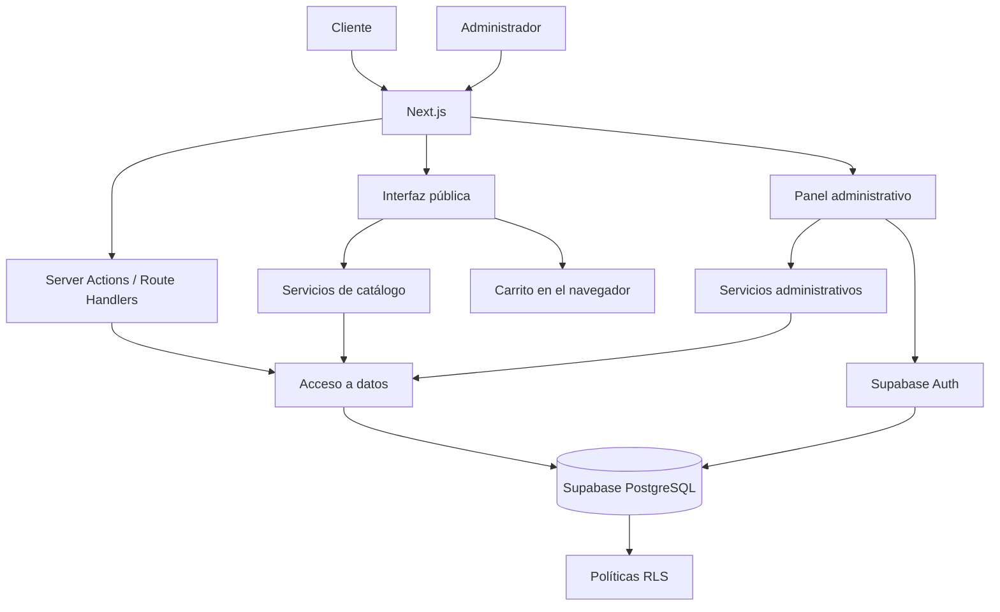
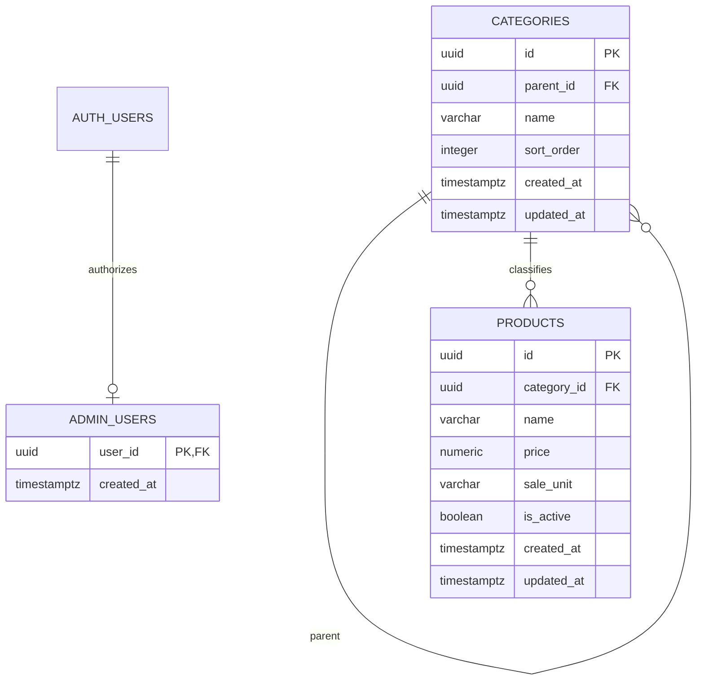

# Diseño técnico — Catálogo online para supermercado

**Estado:** propuesta de diseño técnico del MVP  
**Fecha:** 18 de noviembre de 2026  
**Tecnologías principales:** Next.js, TypeScript, Supabase (PostgreSQL y Auth)

---

## 1. Objetivo y alcance técnico

Este documento define una propuesta de implementación para el MVP del catálogo online del supermercado. Su objetivo es convertir los requerimientos funcionales de `analisis.md` en una arquitectura técnica concreta, manteniendo una solución sencilla, segura y mantenible.

### 1.1. Alcance contemplado

La solución contempla:

- Catálogo público de productos activos.
- Consulta paginada, búsqueda por nombre y filtros por categorías.
- Carrito persistido en el navegador, sin cuenta de cliente.
- Productos vendidos por unidad o por peso.
- Actualización de precios y validación de disponibilidad antes de preparar el mensaje.
- Generación de un mensaje de pedido para WhatsApp.
- Panel privado para administrar productos y categorías.
- Autenticación de una única persona administradora.
- Persistencia de la información del catálogo en Supabase.

No se implementarán pagos, gestión interna de pedidos, stock, entregas, cuentas de clientes ni sincronización con sistemas externos.

### 1.2. Principios de diseño

1. **Simplicidad:** evitar infraestructura y abstracciones que el MVP no necesita.
2. **Seguridad por defecto:** las operaciones administrativas se validan en el servidor y se protegen también mediante RLS.
3. **Una única fuente de verdad:** los datos vigentes de productos, precios y disponibilidad provienen de Supabase.
4. **Cliente no confiable:** el navegador puede enviar identificadores y cantidades, pero nunca se confía en sus precios ni en sus cálculos para preparar el pedido.
5. **Separación de responsabilidades:** interfaz, reglas de negocio y acceso a datos deben mantenerse diferenciados.
6. **Evolución razonable:** evitar acoplar las reglas del negocio a componentes visuales o a mecanismos específicos de presentación.

---

## 2. Arquitectura general

### 2.1. Tecnologías

| Tecnología | Responsabilidad |
|---|---|
| Next.js con App Router | Aplicación web, interfaz, renderizado y endpoints del servidor. |
| React | Construcción de componentes e interacciones. |
| TypeScript | Tipado estático del código. |
| Supabase PostgreSQL | Persistencia de productos, categorías y usuarios administradores. |
| Supabase Auth | Autenticación del administrador. |
| Supabase RLS | Autorización de acceso a los datos. |
| Zod | Validación de datos de entrada y formularios. |
| `@supabase/ssr` | Clientes de Supabase compatibles con el entorno de servidor y navegador. |
| `localStorage` | Persistencia local del carrito del cliente. |
| WhatsApp Click to Chat | Apertura de WhatsApp con el mensaje preparado. |

Se utilizarán versiones estables y compatibles entre sí al iniciar el desarrollo. Las versiones concretas de dependencias se fijarán en el archivo de lock del gestor de paquetes.

### 2.2. Arquitectura lógica

La aplicación será una solución full-stack dentro de Next.js. No se desarrollará un backend independiente.



### 2.3. Responsabilidades por capa

**Interfaz (React / Next.js)**

- Mostrar el catálogo, el carrito y el panel administrativo.
- Gestionar interacciones y estados visuales.
- Validar datos para dar respuesta inmediata al usuario.
- No ser responsable de garantizar la integridad de las operaciones.

**Capa de aplicación (Server Actions y Route Handlers)**

- Recibir y validar operaciones.
- Verificar la sesión y los permisos del administrador.
- Coordinar reglas de negocio.
- Consultar o modificar datos en Supabase.
- Devolver respuestas controladas a la interfaz.

**Capa de dominio**

- Contener reglas independientes de la interfaz: cantidades válidas, cálculo de importes, jerarquía de categorías y preparación del pedido.
- No depender directamente de componentes React.

**Acceso a datos**

- Centralizar las consultas a Supabase.
- Evitar consultas SQL o llamadas a Supabase dispersas por los componentes.
- Aplicar filtros y ordenamientos consistentes.

**Supabase**

- Ser la fuente persistente de productos, categorías y administradores.
- Aplicar restricciones de integridad y políticas RLS.
- No almacenar carritos ni pedidos en este MVP.

### 2.4. Server Components, Client Components y operaciones

Se priorizarán los Server Components para páginas que puedan renderizarse con datos obtenidos en el servidor. Los Client Components se reservarán para interacciones que necesitan estado del navegador, como búsqueda dinámica, controles de cantidades y carrito.

Se utilizarán:

- **Server Components:** carga inicial del catálogo, categorías y páginas administrativas protegidas.
- **Client Components:** buscador, filtros interactivos, controles de cantidad, carrito y formularios con interacción.
- **Server Actions:** operaciones iniciadas desde formularios o acciones de la interfaz, principalmente administración.
- **Route Handlers:** endpoints que necesiten una interfaz HTTP explícita, como consultas dinámicas del catálogo o validación/preparación del pedido para WhatsApp.

No se expondrán credenciales privilegiadas al navegador. La clave `service_role` de Supabase no será necesaria para el funcionamiento habitual y, si se incorpora una tarea administrativa excepcional que la requiera, solo podrá utilizarse en código de servidor y nunca enviarse al cliente.

### 2.5. Flujo de datos y caché

Los productos y precios deben reflejar cambios administrativos con rapidez. Por ello:

- Las consultas de productos y precios se realizarán sin depender de una caché prolongada.
- La preparación del pedido siempre consultará los datos actuales directamente en Supabase.
- Las categorías podrán aprovechar una caché breve o revalidación controlada, siempre que las operaciones administrativas invaliden los datos correspondientes.
- Después de crear, editar, activar, desactivar o eliminar datos, se revalidarán las rutas afectadas.

La caché es una optimización y nunca debe ser la fuente de verdad para confirmar disponibilidad o precios.

---

## 3. Modelo de datos y base de datos

Se utilizará PostgreSQL de Supabase. El modelo inicial tendrá tres tablas propias: `categories`, `products` y `admin_users`.

### 3.1. Diagrama entidad-relación



`AUTH_USERS` representa la tabla `auth.users` administrada por Supabase Auth; no se crea manualmente.

### 3.2. Tabla `categories`

| Campo | Tipo | Restricción / uso |
|---|---|---|
| `id` | `uuid` | PK, generado automáticamente. |
| `parent_id` | `uuid` | FK a `categories.id`, nullable. |
| `name` | `varchar(100)` | Obligatorio. |
| `sort_order` | `integer` | Obligatorio, default `0`. |
| `created_at` | `timestamptz` | Obligatorio, default `now()`. |
| `updated_at` | `timestamptz` | Obligatorio, default `now()`. |

Reglas:

- `parent_id = NULL` identifica una categoría principal.
- Una subcategoría tiene como padre una categoría principal.
- No se permiten más de dos niveles.
- Una categoría no puede ser su propia padre.
- El nombre no puede estar vacío luego de quitar espacios.
- El orden se resuelve por `sort_order` y luego por `name`.
- La eliminación de una categoría con productos o subcategorías asociados se bloqueará. El administrador deberá reasignar los productos y eliminar o reubicar las subcategorías antes de eliminarla.

La regla de profundidad máxima se validará en la capa de aplicación y se reforzará en la base de datos mediante una función/trigger. Así no dependerá exclusivamente de la interfaz administrativa.

### 3.3. Tabla `products`

| Campo | Tipo | Restricción / uso |
|---|---|---|
| `id` | `uuid` | PK, generado automáticamente. |
| `category_id` | `uuid` | FK a `categories.id`, obligatorio. |
| `name` | `varchar(160)` | Obligatorio. |
| `price` | `numeric(12,2)` | Obligatorio, mayor que cero. |
| `sale_unit` | `text` | `unit` o `kg`. |
| `is_active` | `boolean` | Obligatorio, default `true`. |
| `created_at` | `timestamptz` | Obligatorio, default `now()`. |
| `updated_at` | `timestamptz` | Obligatorio, default `now()`. |

Reglas:

- `sale_unit = 'unit'`: el precio corresponde a una unidad y la cantidad solicitada debe ser un entero positivo.
- `sale_unit = 'kg'`: el precio corresponde a un kilogramo y la cantidad solicitada por el cliente se expresa en gramos enteros positivos.
- Cada presentación comercial se registra como un producto independiente.
- No se almacenarán variantes, imágenes ni descripciones.
- `is_active = false` impide mostrar el producto en el catálogo y agregarlo a un pedido nuevo.
- La eliminación física está permitida desde la administración. Las referencias a ese producto guardadas en carritos locales se reconocerán como inválidas cuando se vuelva a consultar el catálogo o se prepare el pedido.

Se utilizará `numeric(12,2)` para evitar almacenar importes monetarios en tipos de punto flotante. Las operaciones de dinero deberán mantener precisión decimal y redondear explícitamente a dos decimales.

### 3.4. Tabla `admin_users`

| Campo | Tipo | Restricción / uso |
|---|---|---|
| `user_id` | `uuid` | PK y FK a `auth.users.id`. |
| `created_at` | `timestamptz` | Obligatorio, default `now()`. |

Solo los usuarios cuyo identificador figure en esta tabla tendrán permisos administrativos. Para el MVP se registrará manualmente un único usuario administrador. No habrá registro público de administradores.

### 3.5. Relaciones y eliminación

- Un producto debe pertenecer a una categoría.
- Una categoría puede contener productos y subcategorías.
- No se permitirá eliminar una categoría si todavía tiene productos o subcategorías asociados (`ON DELETE RESTRICT`).
- La eliminación de un producto será física. Los carritos no se guardan en la base de datos, por lo que no existe una operación de limpieza centralizada: el navegador detectará el identificador inexistente al sincronizar o validar el carrito y exigirá quitarlo.
- No se implementará borrado en cascada de categorías hacia productos.

### 3.6. Índices y restricciones

Se crearán, como mínimo:

- Índice para productos activos y orden alfabético (`is_active`, `name`, `id`).
- Índice sobre `products.category_id`.
- Índice sobre `categories.parent_id` y su orden.
- Restricción `CHECK (price > 0)`.
- Restricción `CHECK (sale_unit IN ('unit', 'kg'))`.
- Restricción para evitar nombres vacíos.
- Restricción de integridad para las relaciones indicadas.

La búsqueda por nombre comenzará con una búsqueda insensible a mayúsculas y minúsculas (`ILIKE`). Si el volumen real de productos lo justificara, se evaluará un índice especializado de texto; no se incorporará complejidad de búsqueda avanzada sin necesidad comprobada.

### 3.7. Migraciones y datos iniciales

El esquema se mantendrá mediante migraciones SQL versionadas en el repositorio. No se realizarán cambios manuales exclusivos desde el panel de Supabase en producción.

Se incluirán scripts o instrucciones para:

- Crear tablas, índices, restricciones, funciones y políticas RLS.
- Crear el primer usuario administrador.
- Cargar categorías y productos iniciales, si corresponde.
- Aplicar las migraciones en desarrollo y producción.

---

## 4. Autenticación y autorización

### 4.1. Autenticación

Se utilizará Supabase Auth con correo electrónico y contraseña para el único administrador.

- El acceso administrativo estará disponible en `/admin/login`.
- No existirá formulario de registro público.
- La cuenta inicial se creará desde Supabase o mediante un procedimiento controlado.
- La sesión se gestionará mediante cookies seguras usando `@supabase/ssr`.
- El cierre de sesión invalidará la sesión y redirigirá al login.

No se solicitará autenticación a los clientes del catálogo.

### 4.2. Protección de rutas

Las rutas bajo `/admin` deberán verificar la sesión y la autorización del usuario en el servidor. Si no existe sesión válida, se redirigirá al login. Si existe sesión pero el usuario no está autorizado, se responderá con acceso denegado o redirección segura.

La protección visual o el ocultamiento de enlaces no constituye autorización: cada operación administrativa debe volver a comprobar los permisos en el servidor.

### 4.3. Row Level Security (RLS)

Se habilitará RLS en las tablas propias.

Políticas previstas:

| Tabla | Lectura pública | Escritura |
|---|---|---|
| `products` | Solo productos activos. | Solo administrador. |
| `categories` | Lectura pública. | Solo administrador. |
| `admin_users` | No se expone públicamente. | Solo mediante procedimiento controlado. |

La autorización administrativa se comprobará mediante la pertenencia de `auth.uid()` a `admin_users`.

La política pública de productos debe impedir que el cliente obtenga productos inactivos mediante consultas directas. Las operaciones del servidor que preparan un pedido también deberán verificar `is_active`, incluso si el usuario manipuló el navegador.

La tabla `admin_users` no debe permitir que un usuario se otorgue permisos a sí mismo. Su mantenimiento se hará desde el entorno confiable de Supabase.

### 4.4. Secretos y variables de entorno

Variables esperadas:

```env
NEXT_PUBLIC_SUPABASE_URL=
NEXT_PUBLIC_SUPABASE_ANON_KEY=
SUPABASE_SERVICE_ROLE_KEY=
WHATSAPP_PHONE_NUMBER=
```

`SUPABASE_SERVICE_ROLE_KEY` solo se configurará si alguna operación de mantenimiento la requiere. No se importará desde módulos compartidos con el cliente ni se expondrá mediante variables `NEXT_PUBLIC_`.

El número de WhatsApp se almacenará como configuración de servidor. Debe indicarse en formato internacional, solo con dígitos y código de país, sin `+`, espacios ni guiones para construir el enlace.

---

## 5. Estructura del proyecto

Se propone una estructura por funcionalidades, separando interfaz, lógica de negocio y acceso a datos.

```text
src/
├── app/
│   ├── (store)/
│   │   ├── page.tsx
│   │   ├── carrito/
│   │   │   └── page.tsx
│   │   └── layout.tsx
│   ├── admin/
│   │   ├── login/
│   │   │   └── page.tsx
│   │   ├── productos/
│   │   │   ├── page.tsx
│   │   │   ├── nuevo/
│   │   │   │   └── page.tsx
│   │   │   └── [id]/
│   │   │       └── page.tsx
│   │   ├── categorias/
│   │   │   └── page.tsx
│   │   └── layout.tsx
│   ├── api/
│   │   ├── products/
│   │   │   └── route.ts
│   │   └── checkout/
│   │       └── prepare/
│   │           └── route.ts
│   ├── layout.tsx
│   └── globals.css
│
├── components/
│   ├── ui/
│   ├── catalog/
│   ├── cart/
│   └── admin/
│
├── features/
│   ├── products/
│   │   ├── components/
│   │   ├── schemas/
│   │   ├── actions.ts
│   │   ├── queries.ts
│   │   └── types.ts
│   ├── categories/
│   │   ├── components/
│   │   ├── schemas/
│   │   ├── actions.ts
│   │   ├── queries.ts
│   │   └── types.ts
│   ├── cart/
│   │   ├── components/
│   │   ├── hooks/
│   │   ├── storage.ts
│   │   ├── calculations.ts
│   │   └── types.ts
│   └── checkout/
│       ├── schemas/
│       ├── prepare-order.ts
│       └── types.ts
│
├── lib/
│   ├── supabase/
│   │   ├── client.ts
│   │   ├── server.ts
│   │   └── proxy.ts
│   ├── auth/
│   │   └── permissions.ts
│   ├── validations/
│   ├── formatters/
│   └── constants/
│
└── proxy.ts

supabase/
├── migrations/
└── seed.sql

tests/
├── unit/
├── integration/
└── e2e/
```

La estructura es orientativa y podrá ajustarse durante la implementación sin alterar las responsabilidades definidas.

### 5.1. Criterios de organización

- `app/`: rutas, layouts y composición de páginas.
- `components/ui/`: componentes visuales genéricos y reutilizables.
- `components/catalog/`, `cart/` y `admin/`: componentes compartidos de esas áreas.
- `features/`: lógica y componentes propios de cada funcionalidad.
- `lib/supabase/`: creación de clientes Supabase para servidor y navegador.
- `lib/auth/`: comprobaciones de sesión y permisos.
- `lib/validations/`: esquemas compartidos cuando no pertenecen a una funcionalidad concreta.
- `supabase/migrations/`: evolución versionada de la base de datos.
- `tests/`: pruebas automatizadas.

No se crearán capas o archivos vacíos por anticipado. Se incorporarán cuando una funcionalidad los necesite.

### 5.2. Convenciones

- TypeScript en modo estricto.
- Nombres de tablas y columnas en `snake_case`.
- Variables, funciones y archivos en `camelCase` o `kebab-case`, manteniendo una convención consistente.
- Componentes React en `PascalCase`.
- Tipos derivados del esquema de Supabase cuando sea posible.
- Validación de entradas con esquemas Zod.
- Componentes de servidor por defecto; agregar `'use client'` solo cuando sea necesario.

---

## 6. Diseño técnico de los módulos funcionales

### 6.1. Catálogo público

**Ruta principal:** `/`

La página inicial cargará:

- Una cantidad inicial de productos activos, ordenados alfabéticamente.
- Las categorías disponibles.
- Los datos necesarios para mostrar nombre, precio y unidad de venta.

Se propone un tamaño inicial de página de **24 productos**. Es un valor inicial de implementación, configurable y ajustable luego de probar el rendimiento y la experiencia de uso.

La consulta se ordenará por `name` y, como segundo criterio estable, por `id`. Se utilizará paginación para cargar los siguientes resultados sin recuperar todo el catálogo de una sola vez.

**Búsqueda y filtros**

- Búsqueda parcial por nombre, insensible a mayúsculas y minúsculas.
- Debounce aproximado de 300 ms para evitar consultas por cada pulsación.
- Filtro por categoría.
- Al seleccionar una categoría principal se incluirán sus subcategorías.
- Búsqueda y categoría se aplicarán conjuntamente.
- Al cambiar búsqueda o filtro se reiniciará la paginación.
- Si no hay resultados, se mostrará un estado vacío y una acción para limpiar los filtros.

El filtro de categoría se aplicará en el servidor/consulta a Supabase y no únicamente sobre los productos de la página ya cargada, para no ocultar coincidencias que se encuentren en páginas posteriores.

**Consulta pública**

Las consultas devolverán solo los campos necesarios para el catálogo. Se excluirán productos inactivos mediante RLS y mediante el filtro explícito de la consulta.

### 6.2. Carrito

**Persistencia elegida:** `localStorage`.

No se creará una tabla de carritos en Supabase porque los clientes no tienen cuenta y no se requiere sincronizar el carrito entre dispositivos.

Estructura conceptual almacenada:

```ts
type CartItem = {
  productId: string;
  quantity: number;
};

type Cart = {
  version: 1;
  items: CartItem[];
};
```

El carrito no almacenará precios ni nombres como datos autoritativos. Estos datos se recuperarán del catálogo vigente.

**Comportamiento**

- Al agregar un producto existente, se acumula la cantidad en una única línea.
- Para productos `unit`, la cantidad es un entero positivo de unidades.
- Para productos `kg`, la cantidad es un entero positivo de gramos.
- Se podrá editar la cantidad y eliminar una línea.
- El carrito se guardará después de cada modificación.
- Se validará la estructura recuperada de `localStorage`; si está corrupta o tiene una versión incompatible, se descartará de forma controlada.
- Se manejará el estado de hidratación para evitar diferencias entre el renderizado inicial del servidor y el estado recuperado del navegador.

**Sincronización con el catálogo**

Al abrir el carrito y antes de preparar el mensaje, se consultarán los productos referenciados:

- Si siguen activos, se actualizarán nombre, precio y unidad mostrados.
- Si cambiaron de precio, se recalcularán los importes.
- Si están inactivos o ya no existen, se marcarán como no disponibles.
- Una línea no disponible no podrá incluirse en el mensaje y deberá eliminarse manualmente para continuar.

La interfaz permitirá quitar del carrito los productos no disponibles. No se eliminarán silenciosamente, para que el cliente entienda por qué cambió el contenido del pedido.

### 6.3. Cálculos monetarios y cantidades

Todos los importes se mostrarán con dos decimales cuando corresponda y con formato local argentino (`es-AR`).

**Producto por unidad**

`subtotal = precio_unitario × cantidad`

**Producto por peso**

`subtotal = precio_por_kg × gramos_solicitados / 1000`

El precio por kilogramo se almacenará en `numeric(12,2)`. Para evitar errores de punto flotante, los cálculos monetarios se implementarán con aritmética decimal o enteros en centavos y una regla de redondeo explícita.

Propuesta de redondeo inicial: redondear cada subtotal de línea a dos decimales y sumar los subtotales ya redondeados. Esta regla deberá utilizarse de forma idéntica en la interfaz y en el servidor.

El total se identificará siempre como **estimativo**. En productos por peso, el importe final puede cambiar según el peso realmente preparado; también puede cambiar por actualizaciones de precios.

### 6.4. Preparación del pedido y WhatsApp

No se creará una entidad `orders` ni se registrará el pedido en la base de datos en este MVP.

Flujo técnico:

1. El cliente solicita preparar el pedido.
2. El navegador envía al servidor únicamente los identificadores de productos y las cantidades.
3. El servidor valida el formato y los límites de las cantidades.
4. El servidor consulta en Supabase todos los productos solicitados.
5. Comprueba que todos existan y estén activos.
6. Obtiene precios, nombres y unidades vigentes desde la base de datos.
7. Calcula los subtotales y el total estimativo.
8. Genera el texto del pedido y construye el enlace de WhatsApp.
9. Devuelve el enlace a la interfaz.
10. La interfaz abre WhatsApp para que el cliente revise y envíe manualmente el mensaje.

Si falta un producto, está inactivo o cambió de forma incompatible, el servidor no generará el enlace. Devolverá los productos afectados para que el cliente pueda corregir el carrito.

**Contenido mínimo del mensaje**

- Nombre del producto.
- Cantidad y unidad (`unidades` o `gramos`).
- Precio utilizado para el cálculo.
- Subtotal estimado por línea.
- Total estimado.
- Aclaración de que los importes son estimativos y sujetos a confirmación del supermercado.

El texto se codificará correctamente como parámetro de URL. Se utilizará el enlace oficial de Click to Chat (`https://wa.me/NUMERO?text=...`), con el número configurado en formato internacional.

Abrir WhatsApp no confirma el envío. La aplicación no mostrará el pedido como recibido ni confirmado y no limpiará el carrito automáticamente solo por haber abierto el enlace. El cliente podrá vaciarlo manualmente.

### 6.5. Administración de productos

**Rutas sugeridas:**

- `/admin/productos`
- `/admin/productos/nuevo`
- `/admin/productos/[id]`

Operaciones:

- Listar productos, incluyendo activos e inactivos.
- Crear producto.
- Editar nombre, categoría, precio y unidad de venta.
- Activar/desactivar.
- Eliminar con confirmación explícita.

Las operaciones se implementarán en el servidor y requerirán autorización administrativa. Los datos se validarán con Zod y las restricciones de PostgreSQL actuarán como última garantía.

Al eliminar un producto, los carritos locales que aún lo referencien lo detectarán como inexistente al sincronizar o preparar el pedido.

### 6.6. Administración de categorías

**Ruta sugerida:** `/admin/categorias`

Operaciones:

- Listar categorías y subcategorías.
- Crear categorías principales y subcategorías.
- Editar nombres.
- Modificar orden.
- Eliminar categorías sin dependencias.

No se permitirá crear una subcategoría de otra subcategoría. Tampoco se permitirá eliminar una categoría que tenga productos o subcategorías asociados. La interfaz explicará qué debe reasignarse o eliminarse previamente.

### 6.7. Contratos de operaciones principales

| Operación | Entrada | Resultado / regla |
|---|---|---|
| Listar productos | Página, búsqueda y categoría | Productos activos paginados. |
| Crear producto | Datos del producto | Producto creado si el usuario es administrador y los datos son válidos. |
| Editar producto | ID y campos modificados | Producto actualizado. |
| Cambiar disponibilidad | ID y `is_active` | Estado actualizado. |
| Eliminar producto | ID | Eliminación física; los carritos locales lo detectarán como inexistente. |
| Crear/editar categoría | Datos de categoría | Respeta jerarquía máxima de dos niveles. |
| Eliminar categoría | ID | Solo si no tiene productos ni subcategorías asociados. |
| Preparar pedido | IDs y cantidades | Datos vigentes validados y enlace de WhatsApp, o errores por productos no disponibles. |

---

## 7. Validaciones, errores y consistencia

### 7.1. Validaciones de productos

- Nombre obligatorio, sin espacios al inicio/final y dentro del máximo definido.
- Precio numérico mayor que cero, con hasta dos decimales.
- Unidad de venta limitada a `unit` o `kg`.
- Categoría existente.
- No permitir valores inválidos aunque se manipule el formulario desde el navegador.

### 7.2. Validaciones de cantidades

- Deben ser números enteros mayores que cero.
- Los productos por unidad solo aceptan unidades enteras.
- Los productos por peso aceptan gramos enteros.
- Se establecerá un máximo técnico razonable para evitar cantidades absurdas o desbordes.
- El servidor repetirá todas las validaciones antes de preparar el mensaje.

El máximo concreto de cantidad deberá quedar centralizado en una constante y ajustarse con el negocio si fuera necesario.

### 7.3. Validaciones de categorías

- Nombre obligatorio.
- Una categoría principal no puede tener padre.
- Una subcategoría solo puede depender de una categoría principal.
- No se permiten ciclos ni más de dos niveles.
- No se permite eliminar categorías con dependencias.

### 7.4. Consistencia del pedido

La preparación del mensaje será una operación de validación puntual contra el estado actual de la base de datos. No representa una reserva de productos ni garantiza que el precio o la disponibilidad sigan iguales después de abrir WhatsApp.

Si un producto no está disponible, se bloqueará la generación del mensaje hasta que se quite del carrito. Si un precio cambió, se utilizará el precio vigente y se actualizará el importe mostrado en la respuesta de preparación.

### 7.5. Errores y respuestas

Se utilizarán respuestas controladas y mensajes comprensibles para el usuario. No se expondrán detalles internos, SQL, claves ni trazas técnicas en la interfaz.

Casos principales:

| Situación | Comportamiento |
|---|---|
| Error de conexión | Informar que no se pudo cargar o guardar la información y permitir reintentar. |
| Sesión vencida | Redirigir al login administrativo. |
| Usuario sin permisos | Denegar la operación. |
| Datos inválidos | Mostrar errores junto a los campos correspondientes. |
| Producto desactivado/eliminado | Marcarlo como no disponible y exigir quitarlo del carrito. |
| Categoría con dependencias | Impedir eliminación e informar qué dependencias resolver. |
| Carrito corrupto | Recuperarlo como vacío y continuar sin romper la página. |
| WhatsApp no disponible o enlace no abierto | Mantener el carrito y permitir reintentar o copiar el detalle. |

Los errores del servidor se registrarán en logs sin incluir secretos ni información innecesaria del cliente.

### 7.6. Concurrencia y cambios simultáneos

No se implementará bloqueo de productos ni reserva de stock. Dos administradores no operarán simultáneamente en el MVP.

La consulta final previa a WhatsApp reducirá el riesgo de usar precios o disponibilidad desactualizados, pero no elimina la posibilidad de que el comercio cambie los datos inmediatamente después. El mensaje deja explícito que el pedido y los importes requieren confirmación del supermercado.

---

## 8. Testing

Se propone combinar pruebas unitarias, de integración y end-to-end.

### 8.1. Pruebas unitarias

Se probarán funciones puras y reglas de negocio:

- Cálculo de subtotal por unidad.
- Cálculo proporcional por gramos.
- Redondeo de importes.
- Suma del total estimativo.
- Acumulación de cantidades del mismo producto.
- Validación de cantidades según unidad de venta.
- Serialización y recuperación del carrito.
- Generación y codificación del mensaje de WhatsApp.
- Validación de jerarquía de categorías.

### 8.2. Pruebas de integración

Con un proyecto Supabase Cloud de desarrollo separado de producción. Supabase local puede utilizarse como alternativa de pruebas, pero no es el entorno previsto para este proyecto:

- Lectura pública de productos activos.
- Imposibilidad de leer productos inactivos desde el cliente público.
- CRUD administrativo de productos y categorías.
- Restricciones de claves foráneas y checks.
- Restricción de eliminación de categorías con dependencias.
- Políticas RLS para usuarios autenticados y no autorizados.
- Validación de productos y precios durante la preparación del pedido.

### 8.3. Pruebas end-to-end

Flujos prioritarios:

1. Un visitante abre el catálogo y navega por productos.
2. Busca un producto y combina búsqueda con una categoría.
3. Agrega un producto por unidad al carrito.
4. Agrega un producto por peso indicando gramos.
5. Cierra y vuelve a abrir la página y recupera el carrito.
6. Modifica cantidades y elimina líneas.
7. Un administrador cambia un precio y el carrito refleja el valor actualizado.
8. Un administrador desactiva un producto y el carrito impide preparar el pedido hasta quitarlo.
9. Un administrador elimina un producto y el carrito detecta que ya no existe.
10. El cliente prepara el mensaje y se abre WhatsApp con el detalle correcto.
11. Un usuario no autenticado intenta acceder al panel y es enviado al login.
12. Un usuario autenticado sin autorización intenta ejecutar una operación administrativa y es rechazado.

### 8.4. Herramientas sugeridas

- Vitest para pruebas unitarias y de integración de lógica.
- Playwright para pruebas end-to-end.
- Un proyecto Supabase Cloud separado de producción para pruebas de base de datos. Supabase local es opcional.

Las pruebas nunca deberán ejecutarse contra la base de datos de producción.

---

## 9. Infraestructura y despliegue

### 9.1. Entornos

Se contemplan al menos:

- **Desarrollo:** Next.js local conectado a un proyecto Supabase Cloud de desarrollo. Supabase local es opcional y no forma parte del flujo previsto.
- **Producción:** aplicación desplegada y proyecto Supabase de producción.

No se utilizarán datos reales de clientes en entornos de prueba.

### 9.2. Hosting

Se propone desplegar Next.js en Vercel por su integración directa con Next.js. Supabase se utilizará como servicio administrado de PostgreSQL y autenticación.

La elección de hosting no impide utilizar otro proveedor compatible con las capacidades de Next.js que requiera el proyecto.

### 9.3. Proceso de despliegue

1. Mantener el código en un repositorio Git.
2. Ejecutar lint, chequeo de tipos y pruebas antes de integrar cambios.
3. Aplicar migraciones de base de datos de forma controlada.
4. Configurar variables de entorno por entorno.
5. Desplegar la aplicación.
6. Verificar autenticación, catálogo, administración y preparación de WhatsApp.

Las migraciones deberán aplicarse antes de desplegar código que dependa de cambios de esquema.

### 9.4. Backups y recuperación

Se utilizarán las herramientas de backup disponibles en el plan de Supabase elegido. Antes de cambios importantes del esquema se deberá contar con una copia recuperable o un procedimiento de restauración probado.

El repositorio conservará las migraciones, pero estas no reemplazan un backup de los datos.

### 9.5. Monitoreo

Para el MVP será suficiente comenzar con:

- Logs de errores del servidor.
- Logs de despliegue.
- Seguimiento de errores de frontend mediante una herramienta opcional si el uso lo justifica.
- Verificación periódica de disponibilidad del catálogo.

No se incorporará una plataforma compleja de observabilidad hasta que el volumen o la operación lo requieran.

---

## 10. Decisiones técnicas consolidadas

| Tema | Decisión |
|---|---|
| Aplicación | Next.js App Router + TypeScript. |
| Backend | Funcionalidades de servidor de Next.js; no habrá backend independiente. |
| Base de datos | Supabase PostgreSQL. |
| Autenticación | Supabase Auth solo para administrador. |
| Autorización | RLS + verificación de permisos en servidor. |
| Administradores | Un único usuario autorizado mediante `admin_users`. |
| Carrito | `localStorage`; no se persiste en Supabase. |
| Datos del carrito | Solo ID de producto y cantidad. |
| Fuente de precios | Supabase; nunca confiar en precios del navegador. |
| Disponibilidad | Campo `is_active`; sin gestión de stock. |
| Productos por peso | Precio por kg y cantidad solicitada en gramos enteros. |
| Dinero | `numeric(12,2)` en PostgreSQL y cálculos decimales/centavos. |
| Catálogo | Productos activos, orden alfabético y paginación de 24 iniciales. |
| Búsqueda | `ILIKE`, combinable con filtro de categoría. |
| Categorías | Relación autorreferenciada con máximo dos niveles. |
| Eliminación de categorías | Restringida si hay productos o subcategorías asociadas. |
| Eliminación de productos | Física; los carritos locales detectan IDs inexistentes. |
| Pedido | No se registra en base de datos. |
| WhatsApp | Enlace Click to Chat con datos validados y precios vigentes. |
| Testing | Vitest + Playwright y Supabase de desarrollo. |
| Hosting propuesto | Vercel + Supabase. |
| Migraciones | SQL versionado en el repositorio. |

---

## 11. Decisiones pendientes antes o durante la implementación

El diseño propone valores iniciales para que el desarrollo pueda avanzar. Los siguientes puntos conviene confirmar o ajustar al implementar:

1. **Redondeo monetario:** se propone redondear cada subtotal de línea a dos decimales y luego sumar. Confirmar que esta regla coincide con el criterio comercial.
2. **Límites de cantidades:** definir máximos técnicos para unidades y gramos. Se centralizarán para poder ajustarlos.
3. **Categorías vacías:** definir si se muestran en el filtro público. La propuesta inicial es mostrar categorías que tengan productos activos propios o en sus subcategorías.
4. **Productos sin categoría:** el diseño exige una categoría. Si se necesitara permitir productos sin clasificar, habría que modificar esa regla explícitamente.
5. **Número de WhatsApp:** configurar el número comercial en el entorno de producción.
6. **Hosting y plan de Supabase:** confirmar proveedor, región y plan según costos, límites y necesidades de operación.
7. **Política de backup:** elegir la frecuencia y retención disponibles en el plan contratado.

Estas decisiones no justifican ampliar el alcance funcional del MVP; son parámetros y detalles operativos del diseño.

---

## 12. Fuera de alcance técnico

No se implementarán en esta versión:

- Tablas de clientes, carritos persistidos o pedidos.
- Pagos, facturación o confirmaciones de pago.
- Reservas o descuentos de stock.
- Gestión de inventario.
- Gestión de entregas o repartidores.
- Notificaciones automáticas.
- Sincronización con sistemas externos.
- Variantes de productos.
- Imágenes, descripciones, promociones o cupones.
- Historial de pedidos.
- Múltiples sucursales.
- Múltiples roles administrativos.

La arquitectura no debe anticipar estos módulos mediante complejidad innecesaria. Cuando exista una necesidad concreta, se evaluará su incorporación mediante una nueva etapa de análisis y diseño.

---

**Fin del documento de diseño técnico.**
