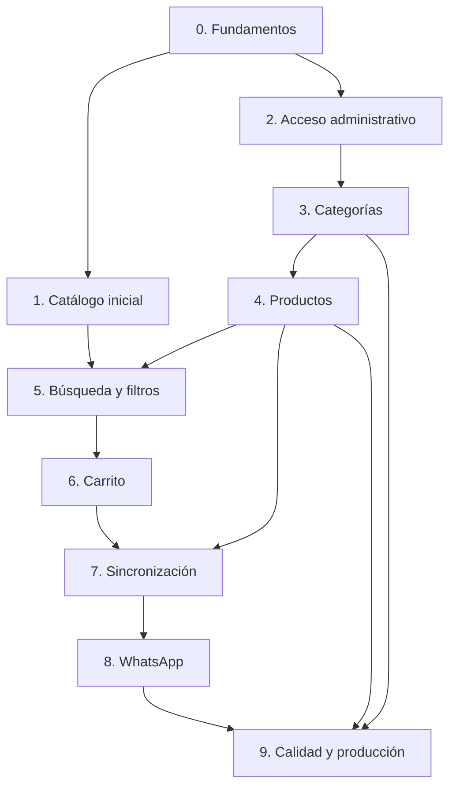

# Plan de implementación — Catálogo online para supermercado

**Proyecto:** catalogo-maryguido  
**Documento:** `implementacion.md`  
**Base documental:** `analisis.md` y `diseno.md`  
**Estado:** propuesta de implementación del MVP  
**Fecha:** 18 de noviembre de 2026

---

## 1. Objetivo del documento

Este documento transforma el análisis funcional y el diseño técnico del catálogo en un plan de implementación ordenado y ejecutable.

La implementación se organizará mediante **vertical slices** (integraciones): cada integración debe entregar una parte funcional de la aplicación, conectando las capas que necesite —interfaz, lógica de aplicación, dominio y persistencia— y dejando el sistema en un estado utilizable.

El objetivo no es construir primero toda la base de datos, después todo el backend y finalmente toda la interfaz. Se avanzará por funcionalidades completas, incorporando la infraestructura y las reglas necesarias a medida que cada funcionalidad las requiera.

### 1.1. Principios de implementación

1. **Cada integración debe dejar algo funcionando.** No se considerará terminada una integración si solo existen tablas, componentes o funciones sin un flujo utilizable.
2. **Mantener el alcance del MVP.** No incorporar stock, pagos, pedidos internos, cuentas de clientes, entregas, promociones ni otras funcionalidades excluidas.
3. **Una única fuente de verdad.** Los productos, precios, categorías y disponibilidad vigentes se obtienen de Supabase.
4. **El navegador no es confiable.** Los datos recibidos del cliente se validan en el servidor. Nunca se confía en precios ni subtotales enviados por el navegador para preparar un pedido.
5. **Seguridad en profundidad.** Las operaciones administrativas se protegen tanto en el servidor como mediante RLS.
6. **Simplicidad antes que abstracción.** No crear capas, componentes genéricos o sistemas de configuración sin una necesidad concreta.
7. **Verificación progresiva.** Cada integración incorpora las pruebas pertinentes y no posterga toda la validación para el final.
8. **Despliegue incremental.** Siempre que sea posible, cada integración debe poder probarse en un entorno de desarrollo o preview sin depender de funcionalidades futuras.

---

## 2. Resumen del orden de implementación

El plan se divide en diez integraciones, numeradas de 0 a 9.

| Orden | Integración | Resultado funcional |
|---:|---|---|
| 0 | Fundamentos del proyecto | Aplicación inicial conectada a Supabase y estructura lista para crecer. |
| 1 | Catálogo público inicial | Los visitantes pueden consultar productos activos y sus precios. |
| 2 | Acceso administrativo | El único administrador puede iniciar y cerrar sesión de forma segura. |
| 3 | Administración de categorías | El administrador puede crear, editar, ordenar y eliminar categorías permitidas. |
| 4 | Administración de productos | El administrador puede mantener productos, precios y disponibilidad. |
| 5 | Búsqueda, filtros y paginación | Los visitantes pueden encontrar productos en el catálogo. |
| 6 | Carrito de compras | Los visitantes pueden armar y conservar un carrito con productos por unidad y por peso. |
| 7 | Sincronización y validación del carrito | El carrito refleja datos vigentes y bloquea productos no disponibles. |
| 8 | Preparación del pedido y WhatsApp | El sistema valida el carrito en el servidor y prepara el mensaje de WhatsApp. |
| 9 | Calidad, endurecimiento y puesta en producción | El MVP queda probado, configurado y publicado. |

La Integración 0 es una base técnica necesaria. Luego, el catálogo público inicial (Integración 1) y el acceso administrativo (Integración 2) son dos caminos que podrían desarrollarse en paralelo una vez establecida esa base. Se recomienda mantener el orden indicado para facilitar la validación paso a paso.

### 2.1. Dependencias entre integraciones



---

## 3. Integración 0 — Fundamentos del proyecto

### Objetivo

Crear la base ejecutable del proyecto, conectar Next.js con Supabase y establecer las convenciones mínimas para que las siguientes integraciones puedan implementarse sin rehacer la estructura.

Esta integración no debe convertirse en una etapa de arquitectura excesiva. Se prepara únicamente lo que las funcionalidades posteriores necesitan.

### Tareas

#### 0.1. Inicialización de la aplicación

- Crear el proyecto Next.js utilizando App Router y TypeScript.
- Habilitar TypeScript estricto.
- Configurar el gestor de paquetes y conservar el archivo de lock.
- Configurar ESLint y los scripts de desarrollo, build, lint y chequeo de tipos.
- Crear el repositorio Git y un `.gitignore` adecuado.
- Crear un `.env.example` con los nombres de las variables necesarias, sin valores secretos.

#### 0.2. Dependencias iniciales

Instalar las dependencias necesarias para la base del proyecto:

- `@supabase/supabase-js`.
- `@supabase/ssr`.
- `zod`.

Las herramientas de testing y otras dependencias se pueden incorporar en la integración correspondiente, evitando instalar herramientas que todavía no se utilizan.

#### 0.3. Conexión con Supabase

- Crear o seleccionar un proyecto Supabase Cloud de desarrollo, separado de producción.
- La CLI apunta al stack local por defecto: enlazar el proyecto Cloud con `npx supabase link --project-ref <PROJECT_REF>` y ejecutar `npx supabase db push --remote --dry-run` antes de `npx supabase db push --remote`.
- No ejecutar `npx supabase db push` sin `--remote`, ya que intentará conectarse al stack local de Supabase.
- Configurar las variables públicas de URL y clave anon.
- Implementar el cliente de Supabase para Server Components y código de servidor.
- Implementar el cliente de navegador cuando sea necesario.
- Mantener cualquier clave privilegiada exclusivamente en el servidor; no configurar `service_role` si el MVP no la necesita.
- Verificar la conexión con una consulta sencilla.

#### 0.4. Estructura inicial

Crear la estructura de carpetas definida en `diseno.md`, incorporando únicamente archivos que ya tengan una responsabilidad concreta.

Estructura de referencia:

```text
src/
├── app/
│   ├── (store)/
│   ├── admin/
│   ├── api/
│   ├── layout.tsx
│   └── globals.css
├── components/
│   └── ui/
├── features/
├── lib/
│   └── supabase/
└── proxy.ts

supabase/
├── migrations/
└── seed.sql

tests/
```

No es necesario crear de antemano todos los directorios internos de cada feature. Se incorporarán al implementar esa funcionalidad.

#### 0.5. Esquema inicial de base de datos

Crear migraciones SQL versionadas para las tablas:

- `categories`.
- `products`.
- `admin_users`.

Incluir desde el inicio:

- Claves primarias y foráneas.
- Restricciones de integridad.
- Restricciones de precio positivo.
- Restricción de `sale_unit` a `unit` o `kg`.
- Restricciones para evitar nombres vacíos.
- Índices previstos en el diseño.
- Campos `created_at` y `updated_at`.
- RLS habilitado en las tablas propias.

Las políticas se deben definir de acuerdo con el diseño: productos activos visibles públicamente, categorías legibles públicamente y escrituras reservadas al administrador. La tabla `admin_users` no debe quedar expuesta a lectura pública ni permitir que un usuario se otorgue permisos.

La regla de profundidad máxima de categorías deberá reforzarse en la base de datos mediante la función o trigger previsto en el diseño, además de validarse en la aplicación cuando se implemente la administración de categorías.

#### 0.6. Layout y estilos globales mínimos

- Crear el layout raíz.
- Definir estilos globales y tipografía.
- Establecer una base visual sencilla y consistente.
- No invertir tiempo todavía en diseñar todas las pantallas.

### Criterios de aceptación

- [ ] La aplicación inicia localmente sin errores.
- [ ] La aplicación compila y supera lint y chequeo de tipos.
- [ ] Se puede realizar una consulta de prueba a Supabase desde el servidor.
- [ ] Las migraciones iniciales se pueden aplicar en el entorno de desarrollo.
- [ ] Las tablas y restricciones principales existen.
- [ ] RLS está habilitado y no hay políticas que otorguen acceso accidental.
- [ ] No hay secretos versionados ni expuestos al navegador.
- [ ] La estructura del repositorio permite incorporar las siguientes integraciones.

### Resultado

Una aplicación base ejecutable, conectada a Supabase y con el esquema inicial versionado. Todavía no hay una funcionalidad de negocio completa para el usuario final.

---

## 4. Integración 1 — Catálogo público inicial

### Objetivo

Permitir que cualquier visitante abra la página principal y consulte productos activos con su nombre, precio y unidad de venta.

Esta es la primera funcionalidad visible del producto. Se implementa antes del panel administrativo para comprobar que la aplicación puede leer y mostrar correctamente la información persistida.

### Tareas

#### 1.1. Consulta de productos

- Crear la consulta de acceso a datos para obtener productos activos.
- Seleccionar únicamente los campos necesarios para la vista pública.
- Aplicar explícitamente el filtro `is_active = true`, además de contar con RLS.
- Ordenar por `name` y luego por `id` para obtener un orden estable.
- Incorporar paginación.
- Utilizar un tamaño inicial de página de 24 productos, configurable.

#### 1.2. Datos iniciales

- Preparar `seed.sql` con categorías y productos de prueba suficientes para verificar el listado y la paginación.
- Evitar cargar datos ficticios en producción.
- Documentar cómo reiniciar o volver a cargar los datos de desarrollo.

#### 1.3. Interfaz pública

- Crear la página principal `/`.
- Mostrar el nombre del producto.
- Mostrar el precio con formato local argentino (`es-AR`).
- Mostrar la unidad de venta:
  - Precio por unidad para `unit`.
  - Precio por kilogramo para `kg`.
- Mantener un diseño simple y adaptable a pantallas móviles.
- No incorporar imágenes ni descripciones.

#### 1.4. Estados de la pantalla

- Estado de carga.
- Estado de error de consulta, con una posibilidad de reintentar.
- Estado vacío cuando no existan productos activos.
- Listado normal cuando existan resultados.

#### 1.5. Seguridad de lectura

Probar la lectura pública con un cliente sin sesión y verificar que:

- Puede leer productos activos.
- No puede leer productos inactivos mediante consultas directas.
- No puede modificar productos ni categorías.

### Criterios de aceptación

- [ ] Un visitante puede ingresar a `/` sin autenticarse.
- [ ] Se muestran solamente productos activos.
- [ ] Cada producto muestra nombre, precio y unidad correctamente.
- [ ] Los productos se ordenan alfabéticamente de manera estable.
- [ ] La primera carga no recupera todo el catálogo: muestra hasta 24 productos.
- [ ] Se puede consultar una página posterior.
- [ ] Los estados vacío y error no rompen la página.
- [ ] Las políticas RLS impiden leer productos inactivos y realizar escrituras desde el cliente público.

### Resultado

El catálogo público inicial está operativo y conectado a datos reales de Supabase. El contenido todavía se administra mediante seed o herramientas de desarrollo; el panel de administración se implementa más adelante.

---

## 5. Integración 2 — Acceso administrativo

### Objetivo

Habilitar el acceso seguro del único administrador y proteger el área privada antes de implementar operaciones de escritura.

### Tareas

#### 2.1. Configuración del administrador

- Crear manualmente la cuenta inicial en Supabase Auth.
- Registrar su `user_id` en `admin_users` mediante un procedimiento controlado.
- No habilitar registro público.
- Documentar el procedimiento de alta inicial sin incluir credenciales en el repositorio.

#### 2.2. Inicio de sesión

- Crear la ruta `/admin/login`.
- Implementar formulario de correo y contraseña.
- Validar los datos recibidos con Zod.
- Autenticar mediante Supabase Auth.
- Mostrar errores comprensibles sin revelar detalles internos.
- Redirigir al área administrativa cuando la autenticación y autorización sean correctas.

#### 2.3. Sesión y cierre de sesión

- Configurar el manejo de sesión mediante cookies con `@supabase/ssr`.
- Implementar el cierre de sesión.
- Al cerrar sesión, invalidar la sesión y redirigir al login.
- Manejar sesiones vencidas.

#### 2.4. Autorización

- Crear una función centralizada para verificar si el usuario autenticado pertenece a `admin_users`.
- Proteger las rutas privadas bajo `/admin`.
- Verificar la autorización en el servidor.
- Volver a comprobar permisos en cada operación administrativa futura.
- No considerar suficiente ocultar enlaces o botones en la interfaz.

#### 2.5. Pantalla administrativa inicial

- Crear el layout privado de `/admin`.
- Mostrar una pantalla inicial sencilla o un panel de navegación.
- Incorporar navegación hacia las secciones que se implementarán posteriormente, sin simular operaciones todavía inexistentes.

### Criterios de aceptación

- [ ] El administrador registrado puede iniciar sesión.
- [ ] Un visitante sin sesión no puede acceder a las rutas privadas.
- [ ] Un usuario autenticado que no figure en `admin_users` no obtiene permisos administrativos.
- [ ] El administrador puede cerrar sesión.
- [ ] Una sesión vencida no permite ejecutar acciones privadas.
- [ ] No existe un formulario de registro público.
- [ ] Las comprobaciones de autorización se ejecutan en el servidor.

### Resultado

El acceso administrativo queda operativo y protegido. Todavía no se pueden administrar categorías ni productos.

---

## 6. Integración 3 — Administración de categorías

### Objetivo

Permitir que el administrador mantenga las categorías y subcategorías utilizadas para organizar el catálogo.

### Tareas

#### 3.1. Consultas y operaciones de categorías

Implementar las operaciones necesarias para:

- Listar categorías principales y subcategorías.
- Crear una categoría principal.
- Crear una subcategoría asociada a una categoría principal.
- Editar el nombre.
- Modificar el orden (`sort_order`).
- Eliminar una categoría cuando no tenga dependencias.

Centralizar el acceso a datos dentro de la feature de categorías.

#### 3.2. Validaciones y reglas de negocio

- Validar nombres obligatorios y quitar espacios sobrantes.
- Validar longitud máxima de nombre.
- Impedir que una categoría sea su propio padre.
- Impedir que una subcategoría tenga otra subcategoría como padre.
- Impedir ciclos y profundidades mayores a dos niveles.
- Repetir las validaciones en el servidor.
- Mantener la protección de base de datos mediante la función o trigger definido en la Integración 0.

#### 3.3. Eliminación segura

- Bloquear la eliminación de una categoría con productos asociados.
- Bloquear la eliminación de una categoría que tenga subcategorías.
- Mostrar un mensaje que indique qué dependencias deben resolverse.
- No eliminar productos ni subcategorías en cascada.

El administrador deberá reasignar los productos y eliminar o reubicar las subcategorías antes de poder eliminar la categoría.

#### 3.4. Interfaz

Crear `/admin/categorias` con:

- Listado jerárquico de categorías.
- Identificación visual de categorías principales y subcategorías.
- Formularios para crear y editar.
- Control para cambiar el orden.
- Acción de eliminación con confirmación.
- Mensajes de éxito y error.
- Estados de carga y listado vacío.

#### 3.5. Disponibilidad pública de categorías

- Crear la consulta pública de categorías.
- Ordenar por `sort_order` y luego por nombre.
- Preparar la estructura necesaria para que el catálogo pueda filtrar por categoría.
- Como decisión inicial del MVP, mostrar en el filtro público las categorías que tengan productos activos propios o en sus subcategorías. Las categorías vacías no necesitan ocupar espacio en la navegación pública.

### Criterios de aceptación

- [ ] El administrador puede listar categorías y subcategorías.
- [ ] Puede crear categorías principales.
- [ ] Puede crear subcategorías únicamente bajo categorías principales.
- [ ] Puede editar nombres y orden.
- [ ] No puede crear una jerarquía de más de dos niveles.
- [ ] No puede eliminar categorías con productos o subcategorías asociadas.
- [ ] Los errores de validación se muestran de forma comprensible.
- [ ] Un usuario no autorizado no puede ejecutar ninguna operación.
- [ ] Las categorías se pueden consultar desde el catálogo público.

### Resultado

La estructura de categorías se administra desde la aplicación y queda disponible para el catálogo. Los productos todavía pueden ser cargados mediante datos de desarrollo hasta completar la siguiente integración.

---

## 7. Integración 4 — Administración de productos

### Objetivo

Permitir que el administrador gestione el catálogo completo: alta, edición, precio, categoría, modalidad de venta, disponibilidad y eliminación de productos.

Esta integración completa el circuito de mantenimiento del contenido del supermercado.

### Tareas

#### 4.1. Consultas y operaciones

Implementar:

- Listado administrativo de todos los productos, activos e inactivos.
- Creación de producto.
- Edición de producto.
- Cambio de precio.
- Cambio de categoría.
- Cambio de modalidad de venta.
- Activación y desactivación.
- Eliminación física.

#### 4.2. Validaciones

Validar en servidor con Zod y respaldar con restricciones de PostgreSQL:

- Nombre obligatorio, sin espacios sobrantes y dentro del máximo permitido.
- Precio mayor que cero.
- Hasta dos decimales.
- `sale_unit` limitado a `unit` o `kg`.
- Categoría existente.
- Estado booleano válido.

La cantidad del cliente no forma parte de los datos del producto; se validará en el módulo de carrito y checkout.

#### 4.3. Interfaz administrativa

Crear las rutas:

- `/admin/productos`
- `/admin/productos/nuevo`
- `/admin/productos/[id]`

La interfaz debe permitir:

- Ver productos activos e inactivos.
- Identificar claramente el estado de cada producto.
- Crear y editar productos.
- Cambiar precios sin modificar el resto de los datos.
- Activar o desactivar un producto.
- Eliminarlo con confirmación explícita.
- Seleccionar una categoría válida.
- Mostrar errores de validación junto al campo correspondiente.

#### 4.4. Actualización del catálogo

Después de crear, editar, activar, desactivar o eliminar:

- Revalidar las rutas públicas y administrativas afectadas.
- Asegurar que el catálogo público no dependa de una caché prolongada.
- Verificar que un producto desactivado deje de aparecer en el catálogo.
- Verificar que un producto eliminado deje de poder consultarse.

No se implementará stock. La disponibilidad se mantiene manualmente mediante `is_active`.

### Criterios de aceptación

- [ ] El administrador puede crear productos con todos los campos requeridos.
- [ ] Puede editar nombre, categoría, precio y modalidad de venta.
- [ ] Puede activar y desactivar productos.
- [ ] Puede eliminar productos con confirmación.
- [ ] Los productos inactivos siguen visibles en la administración, pero no en el catálogo público.
- [ ] Los cambios se reflejan en el catálogo público.
- [ ] Los datos inválidos son rechazados en el servidor.
- [ ] Las restricciones de PostgreSQL impiden persistir datos inválidos.
- [ ] Todas las operaciones están protegidas por autorización administrativa.

### Resultado

El administrador puede mantener autónomamente los productos, precios y disponibilidad. El catálogo ya puede operar con datos reales sin intervención técnica.

---

## 8. Integración 5 — Búsqueda, filtros y paginación

### Objetivo

Permitir que los visitantes encuentren productos de manera ágil, combinando búsqueda por nombre y filtros de categorías.

### Tareas

#### 5.1. Búsqueda por nombre

- Incorporar un campo de búsqueda en el catálogo.
- Realizar búsqueda parcial e insensible a mayúsculas/minúsculas mediante `ILIKE`.
- Aplicar debounce aproximado de 300 ms.
- Ejecutar la búsqueda en el servidor, no únicamente sobre los productos que ya están cargados en el navegador.
- Mantener el estado de búsqueda al cambiar de página.

#### 5.2. Filtro por categoría

- Incorporar un selector o navegación de categorías.
- Permitir seleccionar una categoría principal o subcategoría.
- Al seleccionar una categoría principal, incluir productos asociados a esa categoría y a sus subcategorías.
- Al seleccionar una subcategoría, limitar a esa subcategoría.
- Permitir limpiar el filtro.

#### 5.3. Combinación de filtros

- Aplicar simultáneamente búsqueda y categoría.
- Reiniciar la paginación cuando cambie el término de búsqueda o la categoría.
- Mantener el orden alfabético definido.
- No realizar filtrado exclusivamente en la página ya cargada.

#### 5.4. Paginación y estados

- Mantener el tamaño inicial de 24 productos.
- Permitir consultar los siguientes resultados.
- Evitar duplicados u omisiones entre páginas mediante un orden estable.
- Mostrar un estado vacío cuando no haya coincidencias.
- Ofrecer una acción para limpiar búsqueda y filtros.
- Mostrar estados de carga y error.

### Criterios de aceptación

- [ ] La búsqueda encuentra coincidencias parciales sin distinguir mayúsculas/minúsculas.
- [ ] El filtro por categoría limita correctamente los resultados.
- [ ] Una categoría principal incluye sus subcategorías.
- [ ] La búsqueda y el filtro funcionan simultáneamente.
- [ ] Cambiar los filtros reinicia la paginación.
- [ ] Los resultados se ordenan alfabéticamente.
- [ ] La paginación consulta el conjunto completo de resultados y no solo los productos ya cargados.
- [ ] El catálogo maneja correctamente resultados vacíos y errores.

### Resultado

El catálogo público permite navegar y encontrar productos de forma completa, sin cargar todos los productos de una sola vez.

---

## 9. Integración 6 — Carrito de compras

### Objetivo

Permitir que el cliente agregue productos por unidad y por peso, modifique cantidades, elimine líneas y conserve el carrito entre visitas sin crear una cuenta.

### Tareas

#### 6.1. Modelo y persistencia local

Implementar el modelo definido en el diseño:

```ts
type CartItem = {
  productId: string;
  quantity: number;
};

type Cart = {
  version: 1;
  items: CartItem[];
};
```

- Persistir el carrito en `localStorage`.
- Guardar únicamente el identificador del producto y la cantidad.
- No guardar precios ni nombres como datos autoritativos.
- Validar la estructura al recuperar los datos.
- Si el contenido está corrupto o tiene una versión incompatible, recuperarlo de forma controlada como carrito vacío.
- Manejar la hidratación para evitar diferencias entre servidor y navegador.

#### 6.2. Operaciones del carrito

Implementar:

- Agregar producto.
- Acumular cantidad si el producto ya existe en el carrito.
- Modificar cantidad.
- Eliminar una línea.
- Consultar cantidad de líneas y cantidades.
- Vaciar el carrito manualmente.

Cada producto debe ocupar una sola línea.

#### 6.3. Cantidades según modalidad

**Productos por unidad (`unit`):**

- Cantidad entera mayor que cero.
- El subtotal se calcula como precio unitario por cantidad.

**Productos por peso (`kg`):**

- El precio publicado corresponde a un kilogramo.
- La cantidad solicitada se ingresa en gramos enteros.
- El subtotal se calcula proporcionalmente:

  `subtotal = precio_por_kg × gramos / 1000`

No se impondrán incrementos fijos de 150 gramos.

#### 6.4. Cálculos monetarios

- Utilizar aritmética decimal o enteros en centavos para evitar errores de punto flotante.
- Aplicar una regla única de redondeo: redondear cada subtotal de línea a dos decimales y sumar los subtotales redondeados.
- Utilizar la misma regla en la interfaz y en el servidor.
- Centralizar las funciones de cálculo en el módulo de carrito/dominio.
- Formatear importes para `es-AR`.

Los límites máximos técnicos de cantidades se centralizarán en constantes. Como el diseño no fija valores concretos, se elegirán límites razonables al implementar y se documentarán para poder ajustarlos sin modificar múltiples módulos.

#### 6.5. Interfaz del carrito

Crear la ruta `/carrito` y los componentes necesarios para:

- Mostrar productos y cantidades.
- Mostrar la unidad correspondiente.
- Permitir editar cantidades.
- Permitir eliminar productos.
- Mostrar subtotal por línea.
- Mostrar total estimativo.
- Informar claramente que los importes son estimativos por posibles cambios de precios y variaciones del peso finalmente preparado.
- Mostrar un carrito vacío con una acción para volver al catálogo.

El total estimativo no implica que el comercio haya aceptado o confirmado el pedido.

#### 6.6. Integración con catálogo

- Permitir agregar productos desde el listado.
- Mostrar un indicador de cantidad de productos en el carrito.
- Reflejar inmediatamente los cambios de cantidad.
- No permitir agregar productos que el catálogo no ofrezca como activos.

### Criterios de aceptación

- [ ] Se puede agregar un producto por unidad.
- [ ] Se puede agregar un producto por peso indicando gramos enteros.
- [ ] Agregar varias veces el mismo producto acumula la cantidad en una sola línea.
- [ ] Se puede editar y eliminar cada línea.
- [ ] El carrito persiste al cerrar y volver a abrir el navegador.
- [ ] El carrito almacena solo IDs y cantidades.
- [ ] Los subtotales y el total se calculan correctamente.
- [ ] Los importes se presentan como estimativos.
- [ ] Un carrito corrupto no rompe la aplicación.
- [ ] La interfaz funciona correctamente durante la hidratación.

### Resultado

El cliente puede armar y conservar un carrito completo. En esta etapa se utiliza la información de catálogo disponible; la sincronización obligatoria con datos vigentes se completa en la siguiente integración.

---

## 10. Integración 7 — Sincronización y validación del carrito

### Objetivo

Asegurar que el carrito siempre utilice los datos vigentes de Supabase y que los productos desactivados o eliminados no puedan continuar hacia la preparación del pedido.

Esta integración es crítica porque el carrito persiste localmente mientras los precios y la disponibilidad pueden cambiar en el supermercado.

### Tareas

#### 7.1. Consulta de productos del carrito

Crear una operación de servidor que reciba los identificadores de los productos del carrito y consulte en Supabase su estado actual.

La respuesta debe permitir reconstruir la información necesaria para mostrar cada línea:

- Identificador.
- Nombre vigente.
- Precio vigente.
- Unidad de venta vigente.
- Estado de disponibilidad.

El cliente nunca debe enviar un precio para que el servidor lo considere válido.

#### 7.2. Sincronización al abrir el carrito

Al abrir `/carrito`:

- Consultar los productos referenciados.
- Actualizar nombre, precio y unidad cuando sigan disponibles.
- Recalcular subtotales y total.
- Marcar como no disponibles los productos inactivos.
- Marcar como no disponibles los productos eliminados o inexistentes.
- No eliminar silenciosamente las líneas no disponibles.

#### 7.3. Tratamiento de productos no disponibles

- Mostrar un aviso claro en cada línea afectada.
- Permitir eliminar manualmente el producto.
- Impedir avanzar a la preparación del pedido mientras exista al menos un producto no disponible.
- No permitir que una línea inválida genere un pedido.
- Mantener el resto del carrito.

Esta decisión respeta el requerimiento de que el cliente entienda qué producto dejó de estar disponible y pueda quitarlo expresamente.

#### 7.4. Actualización de precios

- Si el precio cambió, utilizar el precio actual.
- Recalcular el subtotal de la línea.
- Recalcular el total estimativo.
- No conservar el precio anterior como si siguiera vigente.
- Informar al usuario cuando corresponda que hubo cambios en los precios.

#### 7.5. Errores de sincronización

- Si falla la consulta, no asumir que los productos siguen disponibles.
- Informar que no fue posible verificar el carrito.
- Permitir reintentar.
- No borrar el carrito ni marcarlo como validado ante un error de conexión.

### Criterios de aceptación

- [ ] Al abrir el carrito se consultan los datos vigentes de sus productos.
- [ ] Un cambio de precio se refleja en el subtotal y total.
- [ ] Un producto inactivo se marca como no disponible.
- [ ] Un producto eliminado se marca como no disponible.
- [ ] Los productos no disponibles no se eliminan automáticamente.
- [ ] El cliente puede quitarlos manualmente.
- [ ] No se puede preparar el pedido mientras haya líneas no disponibles.
- [ ] Un error de conexión no borra el carrito ni se interpreta como validación exitosa.
- [ ] El navegador no puede imponer precios propios al resultado de sincronización.

### Resultado

El carrito refleja la información vigente del catálogo y protege el flujo de compra frente a cambios de precio, desactivaciones y eliminaciones.

---

## 11. Integración 8 — Preparación del pedido y WhatsApp

### Objetivo

Permitir que el cliente genere un mensaje completo para WhatsApp, utilizando exclusivamente datos actuales y validados en el servidor.

No se creará ni almacenará una entidad de pedido en la base de datos. La aplicación solo preparará el mensaje y abrirá WhatsApp para que el cliente lo revise y lo envíe manualmente.

### Tareas

#### 8.1. Contrato del endpoint

Crear el endpoint:

`POST /api/checkout/prepare`

El navegador enviará únicamente:

- Identificador de producto.
- Cantidad solicitada.

No enviará precios, subtotales ni total como datos confiables.

#### 8.2. Validación de entrada

- Validar el cuerpo con Zod.
- Rechazar estructuras inválidas.
- Validar identificadores.
- Validar cantidades enteras positivas.
- Aplicar los límites técnicos centralizados.
- Rechazar carritos vacíos.
- Evitar aceptar líneas duplicadas sin normalización; el contrato debe mantener una línea por producto.

#### 8.3. Validación contra Supabase

El servidor deberá:

1. Consultar todos los productos solicitados.
2. Comprobar que existan.
3. Comprobar que estén activos.
4. Obtener nombre, precio y unidad vigentes.
5. Verificar que las cantidades sean compatibles con la unidad.
6. Detectar productos faltantes o no disponibles.
7. Si existe algún producto inválido, no generar el enlace y devolver información suficiente para corregir el carrito.

La preparación es una validación puntual, no una reserva de productos ni una garantía de disponibilidad futura.

#### 8.4. Cálculo del pedido

- Calcular cada subtotal en el servidor.
- Aplicar exactamente la regla de redondeo definida para el carrito.
- Calcular el total estimativo.
- No confiar en los cálculos enviados por el navegador.
- Devolver los importes calculados para actualizar la interfaz.

#### 8.5. Construcción del mensaje

El mensaje debe incluir como mínimo:

- Nombre de cada producto.
- Cantidad solicitada.
- Unidad (`unidades` o `gramos`).
- Precio utilizado para el cálculo.
- Subtotal estimado por línea.
- Total estimado.
- Aclaración de que los importes son estimativos y están sujetos a confirmación del supermercado.

El texto debe ser legible y estar correctamente codificado para incluirse como parámetro de URL.

#### 8.6. Enlace de WhatsApp

- Configurar `WHATSAPP_PHONE_NUMBER` en el entorno de servidor.
- Utilizar formato internacional, solo dígitos y código de país, sin `+`, espacios ni guiones.
- Construir el enlace oficial Click to Chat:

  `https://wa.me/NUMERO?text=...`

- No incluir el número comercial en el código fuente como valor fijo.
- No considerar que abrir WhatsApp significa que el mensaje fue enviado.

#### 8.7. Interfaz de preparación

- Mostrar una acción para preparar/enviar el pedido.
- Mientras se procesa, impedir envíos repetidos accidentales.
- Si el servidor devuelve productos no disponibles, actualizar el carrito y solicitar que el cliente los elimine.
- Si los precios cambiaron, mostrar los importes actualizados antes de abrir WhatsApp cuando sea posible.
- Abrir WhatsApp con el mensaje preparado.
- Si no se puede abrir WhatsApp, mantener el carrito y permitir reintentar o copiar el detalle.
- No limpiar automáticamente el carrito.
- No mostrar el pedido como recibido o confirmado.

### Criterios de aceptación

- [ ] El endpoint recibe IDs y cantidades, no precios confiables.
- [ ] El servidor valida la entrada y consulta Supabase.
- [ ] Se rechazan productos inexistentes o inactivos.
- [ ] Se utilizan nombres, precios y unidades vigentes.
- [ ] Los cálculos del servidor coinciden con la regla del carrito.
- [ ] El mensaje incluye todos los datos requeridos.
- [ ] El enlace de WhatsApp está correctamente codificado.
- [ ] El número se obtiene de una variable de entorno.
- [ ] La aplicación no registra pedidos en la base de datos.
- [ ] Abrir WhatsApp no se interpreta como envío o confirmación.
- [ ] El carrito no se vacía automáticamente.
- [ ] Ante un error se conserva el carrito y se ofrece una alternativa para reintentar o copiar el detalle.

### Resultado

El flujo principal del MVP queda completo: el cliente encuentra productos, arma un carrito, valida su vigencia y prepara un mensaje para enviarlo manualmente al supermercado por WhatsApp.

---

## 12. Integración 9 — Calidad, endurecimiento y puesta en producción

### Objetivo

Verificar que todas las funcionalidades trabajen en conjunto, reforzar seguridad y consistencia, y publicar el MVP en un entorno de producción.

Esta integración no debe ser la primera vez que se prueban los flujos: las pruebas unitarias y de integración se incorporan en cada slice. Aquí se ejecuta la validación integral y se cierran los aspectos operativos.

### Tareas

#### 9.1. Pruebas unitarias

Utilizar Vitest para probar las reglas independientes de la interfaz:

- Cálculo por unidad.
- Cálculo por peso.
- Redondeo monetario.
- Suma del total estimativo.
- Acumulación de cantidades.
- Validación de cantidades por unidad de venta.
- Serialización y recuperación del carrito.
- Tratamiento de datos corruptos o versiones incompatibles.
- Generación y codificación del mensaje de WhatsApp.
- Validación de jerarquía de categorías.

#### 9.2. Pruebas de integración

Con un proyecto Supabase Cloud separado de producción. Supabase local es opcional y no es el entorno previsto para este proyecto:

- Lectura pública de productos activos.
- Imposibilidad de leer productos inactivos desde el cliente público.
- CRUD de categorías y productos.
- Restricciones de claves foráneas y checks.
- Bloqueo de eliminación de categorías con dependencias.
- Políticas RLS para visitantes, administrador y usuarios no autorizados.
- Validación de productos y precios durante la preparación del pedido.

#### 9.3. Pruebas end-to-end

Utilizar Playwright para validar los flujos principales:

1. Un visitante abre el catálogo.
2. Busca un producto.
3. Combina búsqueda y filtro por categoría.
4. Navega por la paginación.
5. Agrega un producto por unidad.
6. Agrega un producto por peso.
7. Modifica cantidades y elimina líneas.
8. Cierra y vuelve a abrir la página y recupera el carrito.
9. Un administrador cambia un precio y el carrito refleja el valor actualizado.
10. Un administrador desactiva un producto y el carrito impide preparar el pedido hasta quitarlo.
11. Un administrador elimina un producto y el carrito detecta que ya no existe.
12. El cliente prepara el mensaje y se abre WhatsApp con el detalle correcto.
13. Un visitante sin sesión intenta acceder al panel y es enviado al login.
14. Un usuario autenticado sin autorización intenta ejecutar una operación administrativa y es rechazado.

Las pruebas no se ejecutarán contra la base de datos de producción.

#### 9.4. Revisión de seguridad

- Revisar todas las políticas RLS.
- Verificar que las escrituras administrativas estén protegidas en el servidor.
- Verificar que las operaciones no dependan de validaciones del navegador.
- Confirmar que no se expongan claves secretas.
- Verificar que `admin_users` no sea legible públicamente ni modificable por usuarios no autorizados.
- Probar rutas privadas y operaciones con usuarios no autorizados.
- Revisar que los errores no expongan SQL, claves ni trazas internas.

#### 9.5. Revisión funcional y visual

- Probar en móvil y escritorio.
- Verificar estados de carga, error y vacío.
- Comprobar textos y formato de precios.
- Confirmar que el total estimativo esté claramente identificado tanto en el carrito como en el mensaje.
- Comprobar que los productos no disponibles se puedan quitar.
- Confirmar que el catálogo no incluya funcionalidades fuera del MVP.

#### 9.6. Configuración de producción

- Confirmar el proveedor de hosting; el diseño propone Vercel.
- Crear/configurar el proyecto Supabase de producción.
- Configurar variables de entorno de producción.
- Configurar el número comercial de WhatsApp.
- Crear el usuario administrador inicial y registrarlo en `admin_users`.
- Aplicar migraciones antes de desplegar código que dependa de ellas.
- Cargar categorías y productos reales.
- Configurar backups según el plan contratado.
- Verificar logs de aplicación y despliegue.

#### 9.7. Publicación y smoke test

Después del despliegue, realizar una prueba breve de extremo a extremo:

- Abrir el catálogo público.
- Buscar y filtrar un producto.
- Iniciar sesión como administrador.
- Modificar un producto de prueba y verificar el reflejo público.
- Armar un carrito con productos por unidad y por peso.
- Preparar el mensaje de WhatsApp y comprobar el destinatario y contenido.
- Cerrar sesión y comprobar la protección del panel.

### Criterios de aceptación

- [ ] Las pruebas unitarias principales pasan.
- [ ] Las pruebas de integración de base de datos y RLS pasan.
- [ ] Los flujos E2E prioritarios pasan.
- [ ] No hay errores de lint, build ni chequeo de tipos.
- [ ] Las rutas y operaciones administrativas están protegidas.
- [ ] No se exponen secretos.
- [ ] La aplicación funciona en móvil y escritorio.
- [ ] Las variables de producción están configuradas.
- [ ] Las migraciones están aplicadas en el orden correcto.
- [ ] El usuario administrador puede acceder.
- [ ] El catálogo y el flujo de WhatsApp funcionan en producción.
- [ ] Existe un procedimiento de backup y recuperación acorde al servicio contratado.

### Resultado

El MVP queda publicado y validado para su uso real, dentro del alcance definido en los documentos de análisis y diseño.

---

## 13. Reglas transversales para todas las integraciones

Las siguientes reglas aplican durante todo el desarrollo.

### 13.1. Estructura y responsabilidades

- `app/` contiene rutas, layouts y composición de páginas.
- `features/` contiene lógica y componentes propios de cada funcionalidad.
- `components/` contiene componentes compartidos.
- `lib/` contiene integraciones y utilidades realmente transversales.
- Las consultas a Supabase no deben dispersarse por componentes visuales.
- Los Server Components serán la opción por defecto.
- Los Client Components se utilizarán cuando se necesite estado o interacción del navegador.
- No crear archivos o capas vacías por anticipado.

### 13.2. Validación

- Los formularios pueden validar en el cliente para dar feedback inmediato.
- Toda operación debe volver a validar los datos en el servidor.
- Las restricciones de PostgreSQL deben respaldar las reglas críticas.
- Los errores mostrados al usuario deben ser comprensibles y no revelar detalles internos.

### 13.3. Dinero y cantidades

- Los precios se almacenan en `numeric(12,2)`.
- No utilizar operaciones de punto flotante sin una estrategia explícita de precisión.
- Los importes se formatean para `es-AR`.
- Productos `unit`: cantidades enteras positivas.
- Productos `kg`: cantidades enteras positivas expresadas en gramos.
- La regla de redondeo debe ser idéntica en carrito y servidor.
- El total del carrito y del mensaje siempre se identifica como estimativo.

### 13.4. Caché y actualización

- Los datos de productos y precios no deben depender de una caché prolongada.
- Las operaciones administrativas deben revalidar las rutas afectadas.
- La preparación del pedido siempre consulta Supabase directamente.
- Una caché nunca es fuente de verdad para confirmar disponibilidad o precio.

### 13.5. Seguridad

- No confiar en datos enviados por el navegador.
- No exponer claves privilegiadas.
- Proteger cada operación administrativa, no solo las páginas.
- Mantener RLS habilitado y probado.
- No implementar registro público de administradores.

### 13.6. Fuera de alcance

No incorporar durante estas integraciones:

- Control de stock.
- Reserva o descuento de existencias.
- Pagos online.
- Gestión interna de pedidos.
- Estados de pedidos o entregas.
- Repartidores.
- Cuentas de clientes.
- Historial de compras.
- Fotografías o descripciones.
- Variantes de productos.
- Promociones, cupones o descuentos.
- Integraciones con inventario o sistemas comerciales externos.
- Múltiples sucursales o roles administrativos.

Cualquier incorporación de este tipo requiere una nueva etapa de análisis y priorización.

---

## 14. Decisiones que se resolverán durante la implementación

Los documentos de análisis y diseño dejan algunos parámetros abiertos. Para no bloquear el avance, se propone resolverlos de la siguiente manera, manteniendo el MVP simple.

| Tema | Decisión de implementación |
|---|---|
| Cantidad inicial del catálogo | 24 productos por página, como propone el diseño. |
| Orden del catálogo | `name` y luego `id` para mantener orden estable. |
| Búsqueda | `ILIKE` con debounce aproximado de 300 ms. |
| Categoría principal | Incluye productos de sus subcategorías. |
| Categorías vacías | No se muestran en el filtro público; mostrar categorías con productos activos propios o en subcategorías. |
| Redondeo | Redondear cada subtotal a dos decimales y sumar los subtotales redondeados. |
| Máximos de cantidades | Definir constantes centralizadas al implementar; validar también en servidor. |
| Categorías con dependencias | Bloquear eliminación hasta reasignar productos y resolver subcategorías. |
| Productos eliminados del carrito | Marcarlos como no disponibles al sincronizar; exigir eliminación manual. |
| Actualización de precios | Sincronizar al abrir el carrito y volver a consultar obligatoriamente al preparar el mensaje. |
| Error al preparar WhatsApp | Conservar el carrito, informar el error y permitir reintentar o copiar el detalle. |
| Número de WhatsApp | Variable de entorno `WHATSAPP_PHONE_NUMBER`, en formato internacional solo con dígitos. |
| Hosting | Vercel como propuesta inicial, sujeto a confirmación operativa y de costos. |

Estas decisiones concretan los puntos pendientes sin ampliar el alcance funcional.

---

## 15. Definition of Done por integración

Una integración se considera terminada únicamente cuando cumple todos estos puntos:

- [ ] El flujo funcional previsto puede ejecutarse de principio a fin.
- [ ] La interfaz maneja estados de carga, error y vacío cuando corresponda.
- [ ] Las reglas de negocio están implementadas en la capa adecuada.
- [ ] Las entradas se validan en el servidor.
- [ ] Las operaciones de base de datos respetan RLS y restricciones.
- [ ] Se agregaron pruebas proporcionales a la funcionalidad.
- [ ] No hay errores de TypeScript, lint ni build.
- [ ] Se verificó que no se hayan incorporado funcionalidades fuera del alcance.
- [ ] La integración no rompe las funcionalidades ya implementadas.
- [ ] El código y las migraciones están versionados.

---

## 16. Criterio de finalización del MVP

El MVP se considera implementado cuando:

1. El administrador puede mantener productos, precios, categorías y disponibilidad.
2. Los visitantes pueden consultar el catálogo público.
3. Pueden encontrar productos mediante búsqueda y categorías.
4. Pueden agregar productos por unidad y por peso al carrito.
5. Pueden modificar cantidades y eliminar líneas.
6. El carrito se conserva entre visitas.
7. Los precios se actualizan con los valores vigentes.
8. Los productos desactivados o eliminados no pueden enviarse en el pedido.
9. El total se identifica claramente como estimativo.
10. El cliente puede generar un mensaje completo y enviarlo manualmente mediante WhatsApp.
11. El administrador accede de forma segura al panel.
12. Las pruebas principales y la verificación de producción se completaron.

La aplicación no debe registrar el pedido como confirmado ni asumir que el mensaje fue enviado por el solo hecho de abrir WhatsApp.

---

**Fin del documento de implementación.**
